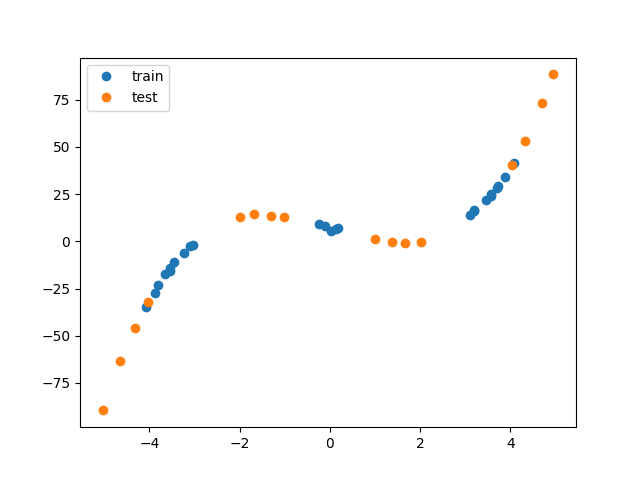
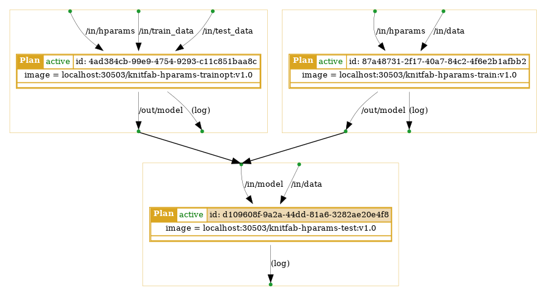

# Knitfabでハイパーパラメータを管理する

Knitfabでハイパーパラメータを管理する方法のチュートリアルです。

### はじめに

####  ハイパーパラメータとその管理の重要性

ハイパーパラメータは機械学習モデルの構成や学習過程を設定するパラメータのことで、畳み込み層のフィルタ数や、最急降下法の学習率などが想定されます。

適切なハイパーパラメータの設定は、よい機械学習モデルの作成に不可欠です。
例えばミニバッチ学習の学習率については、高過ぎると学習の後の方に入力したバッチの影響を強く受けることになり、逆に低過ぎると収束に必要なステップ数が多くなるため、適切な値を設定する必要があると言われています。

適切なハイパーパラメータを探索する方法として、実験を繰り返して手動で探索する方式や、評価のスコアをもとにしてアルゴリズムで探索する方式があります。
どの方式でも実験の入力と結果を保存・管理することで、同じ実験を繰り返すことの予防や、実験の実施忘れの防止に役立ちます。

#### ハイパーパラメータの実装方法

ハイパーパラメータの主な実装方法について、変更可能性とKnitfabでの管理の容易さの観点から説明します。

1. 学習・推論コードに固定
   ハイパーパラメータをコードに直接記載し固定する方法です。
   コード上に記載されたパラメータを書き換える仕組みが必要なので、プログラムからハイパーパラメータを設定に手間がかかります。
   また、コードとハイパーパラメータが混ざるため、管理が難しくなります。
   入力・出力層の特徴量など、プロジェクトを通して変更の可能性が少ない項目に絞って使用します。

2. コマンドライン引数で設定
   学習・推論プログラムにコマンドライン引数を渡すことで、ハイパーパラメータを指定する方法です。
   コマンドとその結果を紐付けることで実験を管理できるようになりましたが、Knitfabはハイパーパラメータも全てデータ(ファイル)として扱うため、Knitfabでの管理はやや難しいと考えられます。

3. 外部ファイルで設定
   ハイパーパラメータを格納したファイルを学習・推論プログラムから読み込み、実行時に設定する方法です。
   ハイパーパラメータをデータとしてKnitfabに登録し、コンテナに渡すことで外部からの設定が可能になります。
   このとき、ハイパーパラメータの種類を区別するために、データのタグの設定に注意する必要があります。

このチュートリアルでは、外部ファイルを使用したハイパーパラメータ管理方法について説明します。

#### チュートリアルの構成

このチュートリアルでは、サンプルの回帰問題を通してKnitfabを使ったハイパーパラメータの管理および探索方法を説明します。
チュートリアルは下記の流れで進行します。

1. サンプルの回帰問題のデータ作成・登録
2. 訓練・推論用のPlanの登録
3. 手動でのハイパーパラメータ探索
4. グリッドサーチを用いたハイパーパラメータ探索

#### 前提
Knitfabの[Getting started](https://knitfab.opst.co.jp/getting-started)を実施し、ローカル環境上のクラスタにKnitfabをインストールし、CLIツールの`knit`をダウンロードしていることが前提です。
また、コマンドの結果のjsonを編集するための`jq`コマンドが実行できることも前提です。

### チュートリアル

このチュートリアルでは、サンプル問題(多項式回帰)を題材に、Knitfabを使ったハイパーパラメータ管理方法について説明します。
以下の流れは、サンプル問題で使用するデータを準備した後、多項式回帰の訓練・評価・ハイパーパラメータサーチ用のPlanを登録し、さらにハイパーパラメータを登録してそれぞれの結果を確認します。

#### サンプル問題設定、データ登録

サンプルで使う回帰(多項式回帰)問題について説明し、データをKnitfabに登録します。

サンプルの回帰問題は、1変数関数 $f(x)=x^3-0.2x^2-7.2x+7.2$ を使って作成されるデータから、元の関数に近い多項式 $a_nx^n+a_{n-1}x^{n-1}\cdots+a_1x+a_0$ の係数を求めるものです。
この問題のハイパーパラメータは多項式の次数 $n$ で、パラメータ(モデル)は多項式の係数と言えます。

訓練データは区間 $D_1=[-4.0, -3.1]\cup[-0.2, 0.2]\cup[3.1, 4.0]$ から、評価データは区間 $D_2=[-5.0, -4.0]\cup[-2.0, -1.0]\cup[1.0, 2.0]\cup[4.0, 5.0]$ からそれぞれ抽出して関数の値を求め、一様乱数の値を加えて作成しました。
グラフにすると、下記のようになります。



データの作成・登録を行います。
下記のスクリプトを実行すると、データを格納した `npz` ファイルが `datasets/train` 、 `datasets/test` ディレクトリにそれぞれ出力されます。

```bash
python generate_dataset.py
```

この段階で、学習データと訓練データをKnitfabに登録しておきます。

```bash
knit data push -t project:hparams -t type:data -t mode:train -n ./datasets/tr
knit data push -t project:hparams -t type:data -t mode:test -n ./datasets/test
```

#### 訓練・評価Planの登録

このチュートリアルで作成するPlanは次の3つです。

1. 訓練データとハイパーパラメータからモデルを作成するPlan(`train`)
2. 訓練データと評価データとハイパーパラメータから、ハイパーパラメータサーチを行うPlan(`train_opt`)
3. 評価データとモデルから評価結果のログを出力するPlan(`test`)

それぞれのPlanの関係は下の図の通りです。



ハイパーパラメータとモデルのデータ形式については、[手動ハイパーパラメータサーチと結果の管理](#手動ハイパーパラメータサーチと結果の管理)および[グリッドサーチ](#グリッドサーチ)にそれぞれ記載しています。

以下ではコンテナの作成からPlanの登録までのコマンドを順に示します。

##### コンテナの作成、レジストリへの登録

下記コマンドでコンテナを作成します。

```bash
docker build -t knitfab-hparams-train:v1.0 -f ./train/Dockerfile ./train
docker build -t knitfab-hparams-trainopt:v1.0 -f ./train_opt/Dockerfile ./train_opt
docker build -t knitfab-hparams-test:v1.0 -f ./test/Dockerfile ./test
```

`docker run`でtrainを動作確認します。

```bash
docker run --rm -it \
    -v "$(pwd)/datasets/train:/in/data" \
    -v "$(pwd)/hparams/2:/in/hparams" \
    -v "$(pwd)/out/train:/out/model" \
    knitfab-hparams-train:v1.0
```

さらに後続のtestが実行できることを確認します。

```bash
docker run --rm -it \
    -v "$(pwd)/datasets/test:/in/data" \
    -v "$(pwd)/out/train:/in/model" \
    knitfab-hparams-test:v1.0
```

trainoptが動作するか確認します(合わせて、結果がtestに適合するか確認します)

```bash
docker run --rm -it \
    -v "$(pwd)/datasets/train:/in/train_data" \
    -v "$(pwd)/datasets/test:/in/test_data" \
    -v "$(pwd)/hparams/opt:/in/hparams" \
    -v "$(pwd)/out/trainopt:/out/model" \
    knitfab-hparams-trainopt:v1.0
docker run --rm -it \
    -v "$(pwd)/datasets/test:/in/data" \
    -v "$(pwd)/out/trainopt:/in/model" \
    knitfab-hparams-test:v1.0
```

コンテナにタグ付けします。`${YOUR_KNITFAB_NODE}`、`${PORT}`はKnitfabのGetting startedのものと同じ内容です。

```
docker tag knitfab-hparams-train:v1.0 ${YOUR_KNITFAB_NODE}:${PORT}/knitfab-hparams-train:v1.0
docker tag knitfab-hparams-test:v1.0 ${YOUR_KNITFAB_NODE}:${PORT}/knitfab-hparams-test:v1.0
docker tag knitfab-hparams-trainopt:v1.0 ${YOUR_KNITFAB_NODE}:${PORT}/knitfab-hparams-trainopt:v1.0
```

レジストリに登録します。

```
docker push ${NODE}:${PORT}/knitfab-hparams-train:v1.0
docker push ${NODE}:${PORT}/knitfab-hparams-test:v1.0
docker push ${NODE}:${PORT}/knitfab-hparams-trainopt:v1.0
```

##### Planの作成と登録

作成したコンテナをKnitfabに登録します。

```
knit plan apply ./knitfab-hparams-train.v1.0.plan.yaml
knit plan apply ./knitfab-hparams-test.v1.0.plan.yaml
knit plan apply ./knitfab-hparams-trainopt.v1.0.plan.yaml
```

これでデータとハイパーパラメータを与えると、コンテナが実行されるようになりました。

#### 手動ハイパーパラメータサーチと結果の管理

手動で実験を繰り返し、人手でハイパーパラメータを探索する方法を体験します。
同時に、Knitfabを使った実験の管理方法を体験します。

訓練プランtrainが受け付けるハイパーパラメータの形式は、次数を1つ含む下記のようなyamlファイルです。

```yaml
deg: 2
```

また、出力のディレクトリには上記のyamlファイルに加えて、多項式の係数を格納したnpzファイルを出力します。
(多項式の係数から次数が定まりますが、深層学習分野ではハイパーパラメータでネットワークを作成した後パラメータ(重み)をロードする方式をよく見かけるので、このチュートリアルでも2つを格納しています)

訓練データと評価データは[サンプル問題設定、データ登録](#サンプル問題設定、データ登録)で登録済みのため、ハイパーパラメータのみを登録して、訓練用Planを実行します。
評価用Planは訓練用Planが終了次第自動的に実行されます。

```bash
knit data push -t project:hparams -t type:hparams -n ./hparams/1
knit data push -t project:hparams -t type:hparams -n ./hparams/2
knit data push -t project:hparams -t type:hparams -n ./hparams/3
knit data push -t project:hparams -t type:hparams -n ./hparams/4
knit data push -t project:hparams -t type:hparams -n ./hparams/5
```

しばらく待ってから、結果を取得します。
コンテナイメージから、評価用PlanのIDを検索し、それに紐づくRunのIDの一覧を`runids.txt`に保存します。

```bash
PLAN_ID=$(knit plan find --image localhost:${PORT}/knitfab-hparams-test:v1.0 | jq '.[0].planId' -r)
knit run find --planid $PLAN_ID --status done | jq -r '.[].runId' > runids.txt
```

`knit run find`の結果の形式は、使用時に確認しておくと良いでしょう。

各RunのIDから評価結果のログ(`test result: resid={スコア}`形式)を取得し、数値のみを取り出し昇順(良い順に)ソートした後標準出力に出力します。

```bash
for rid in $(cat ./runids.txt)
do
  printf "%s %s\n" $rid $(knit run show --log $rid | grep -oE [0-9\.]+)
done | sort -t " " -k 2 -g
```

Run IDとスコアの組がリストになって出力されたので、最初の行のRun IDを環境変数`$RUN_ID`に設定しておきます。

最後に、最も良いハイパーパラメータの内容を`knit pull`でダウンロードして表示します。

```bash
KNIT_ID=$(knit run show ${RUN_ID} | jq -r '.inputs[] | select(.path=="/in/model") | .knitId')
knit data pull $KNIT_ID ./knit_out/
tar xfz ./knit_out/$KNIT_ID.tar.gz -C ./knit_out/
cat ./knit_out/hparams.yaml
```

`knit run show`の結果から、Runに紐づく入力のうち、パスが`/in/model`に一致するデータ(つまりモデル)のKnit IDを取得して、
そのIDのデータを`knit data pull`でローカルに取得しています。

実際のプロジェクトでは、実験の実施と結果の確認を何度か繰り返すと思います。
Knitfabではデータに設定されたタグの組合せから自動的に実験を実施するため、タグを適切に設定できれば、必要な実験を漏れなく重複なく実施できます。

#### グリッドサーチ

ハイパーパラメータサーチの一例として、グリッドサーチによる探索を説明します。

グリッドサーチにも探索範囲のハイパーパラメータを指定する必要があるため、最小次数と最大次数を格納した下記のようなyamlファイルを入力します。

```yaml
min_deg: 1
max_deg: 10
```

自動ハイパーパラメータ探索ではデータの当てはまりの良さを評価する必要があるため、
訓練データとハイパーパラメータの他に評価データも入力します(Planの設定により自動的に入力されます)。

次のコマンドでハイパーパラメータをKnitfabに登録し、Planを実行します。
(手動実行のものと異なる種類のハイパーパラメータを登録しているため、設定するタグは異なるもの`type:hparams_opt`を設定しています。)

```bash
knit data push -t project:hparams -t type:hparams_opt -n ./hparams/opt
```

しばらく待ち、探索Planと後続の評価Planが終了した後、下記のコマンドでPlan ID、Run IDを取得し、探索Planのログを確認します。

```bash
PLAN_ID=$(knit plan find --image "localhost:${PORT}/knitfab-hparams-trainopt:v1.0" | jq -r '.[0].planId')
RUN_ID=$(knit run find --planid $PLAN_ID --status done | jq -r ".[0].runId")
knit run show --log $RUN_ID
```

結果は下記のように、最小次数から最大次数までの次数に対する係数と評価スコアが表示されています。

```
degree=1 fit result: coef=[5.251350963533031, 5.879536939111617], resid@train=[1165.6641597], resid@test=14023.630918232437
degree=2 fit result: coef=[7.7249620214911525, 5.883915600394141, -0.2446357963216555], resid@train=[1121.82847481], resid@test=13935.437581122376
degree=3 fit result: coef=[7.56140307570947, -6.463251927637339, -0.24279748972993254, 0.9491015960850323], resid@train=[13.47475771], resid@test=32.8059286263914
degree=4 fit result: coef=[7.308711228431691, -6.445805348250787, -0.024094044914958257, 0.947894492856051, -0.014888929393223435], resid@train=[10.44714396], resid@test=103.86731375201954
degree=5 fit result: coef=[7.3025937547451445, -5.119861927373514, -0.015005326656074635, 0.736134570688527, -0.015509006583304768, 0.008207229215919775], resid@train=[9.82222772], resid@test=144.95762391186162
degree=6 fit result: coef=[7.30890641062565, -5.131788260921679, -0.10819581809896574, 0.7374636800555691, -0.0011297279971546536, 0.008174588025280684, -0.0005427950431475684], resid@train=[9.79861994], resid@test=203.60682487665284
degree=7 fit result: coef=[7.315020981816899, -6.1420449470134395, -0.12153102440859748, 1.020269032246063, 0.0010126593009601005, -0.016985242427492313, -0.0006291548005148428, 0.0007160111712895606], resid@train=[9.6189392], resid@test=462.6030459483876
degree=8 fit result: coef=[7.311217872713236, -6.130193494927135, 0.038790425677377324, 1.019355024156886, -0.03686499569661115, -0.017054031222440657, 0.0023001836751675485, 0.0007211522090012883, -7.412469966623112e-05], resid@train=[9.61767296], resid@test=610.8012897105868
degree=9 fit result: coef=[7.308514156733216, -6.20258028632639, 0.18506824101755176, 1.2221883516824232, -0.06936416131680721, -0.061998346012684204, 0.004661554263517623, 0.004101941589947937, -0.00013019075345697108, -8.404135239230225e-05], resid@train=[9.59876254], resid@test=370.8754224588814
degree=10 fit result: coef=[6.946942296958921, -5.480150467071077, 16.0983836205391, 1.1861088616304845, -5.106346174786695, -0.07818847805446136, 0.5963182504905198, 0.00589425609337383, -0.030641438226660173, -0.0001351888893080464, 0.0005828416796995882], resid@train=[9.05492826], resid@test=146500.09793385543
```

さらに `knit run find` と `knit data pull` を使って、後続の評価用Planの結果からハイパーパラメータとモデルの組を取得することも可能です。

自動ハイパーパラメータ探索は、訓練・評価を何度か実行するため「訓練を並列で実行して、結果をまとめる」ような方針で作成されていることも想定されます。
そのように実装した場合は、プラン定義の `resource` を確認し、適切な資源を割り当てるように設定すると良いでしょう。

### おわりに

サンプルの回帰問題を通して、Knitfabでハイパーパラメータを管理・探索する方法を説明しました。
実験結果を分析して最適なハイパーパラメータを取得したり、アルゴリズム(グリッドサーチ)でハイパーパラメータを探索したりしました。

